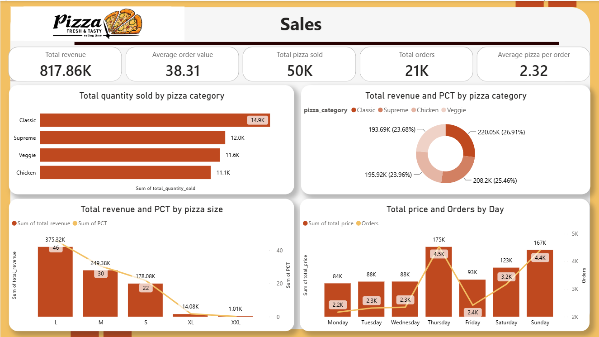
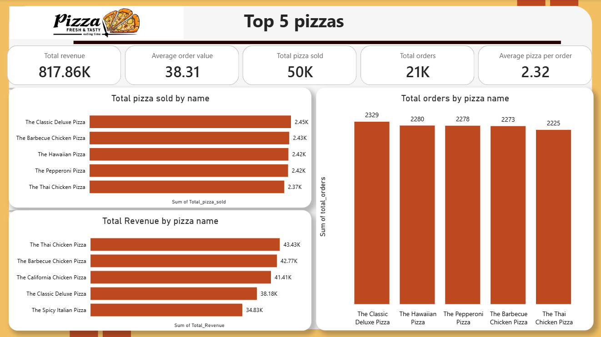
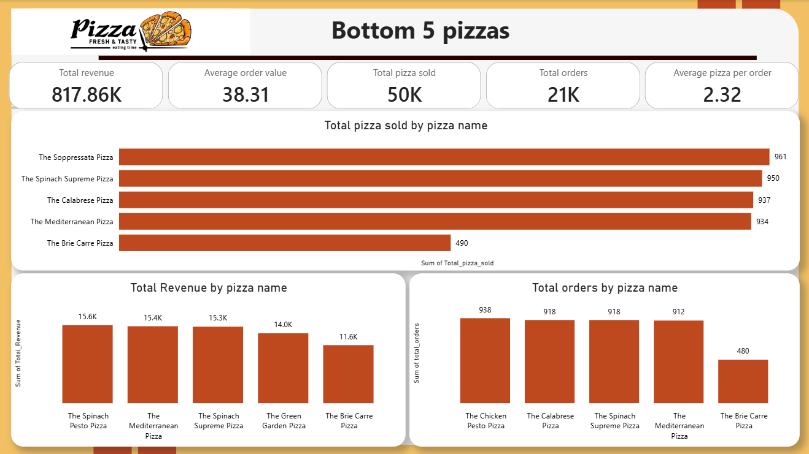
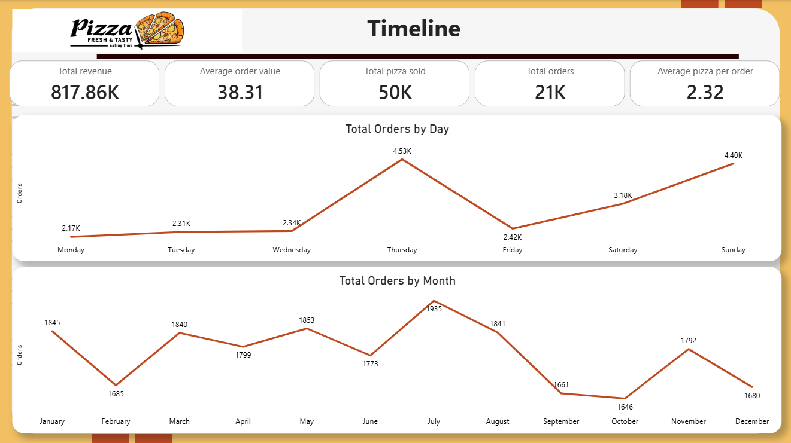

# Pizza Sales Performance Dashboard

Interactive Power BI dashboard that turns raw pizza sales data into business insights across 4 pages: Sales, Top 5 pizzas, Bottom 5 pizzas, and Timeline.

## Business Questions
- Which pizza categories and sizes drive the most revenue?
- Which pizzas are the stars, and which ones underperform?
- When are the busiest days and months?
- How can the shop increase its average order value?

## Tools
- SQL (data extraction and KPI calculations)
- Power BI (data modeling and interactive dashboards)

## Dashboard Pages

### 1. Sales

- Total revenue: $817.86K from 50K pizzas sold across 21K orders
- Average order value: $38.31, with 2.32 pizzas per order
- Classic leads in both volume (14.9K pizzas sold) and revenue ($220K, 26.9% of total)
- Large (L) pizzas generate 46% of total revenue, followed by Medium (30%) and Small (22%)
- Thursday generates the highest revenue ($175K), followed by Sunday ($167K)

### 2. Top 5 Pizzas

- The Thai Chicken Pizza leads in revenue ($43.43K)
- The Classic Deluxe Pizza leads in units sold (2.45K) and orders (2,329)

### 3. Bottom 5 Pizzas

- The Brie Carre Pizza is last in units sold (490), orders (480) and revenue ($11.6K)
- The other bottom pizzas sell 934-961 units, so Brie Carre sells about half as much
- It needs a marketing push or a recipe review

### 4. Timeline

- Thursday is the busiest day (4.53K orders), followed closely by Sunday (4.40K)
- Monday is the slowest day (2.17K orders)
- Thursday and Sunday together account for about 42% of all orders
- July is the top month (1,935 orders), and October is the lowest (1,646)

## Key Takeaways
- Promote Large pizzas and family or group deals, since they drive almost half of revenue
- Plan staff and inventory around Thursdays and Sundays, the peak days
- Run promotions on slow days such as Monday to balance demand
- With 2.32 pizzas per order, upselling add-ons or drinks can increase the average ticket
- Review or promote the Brie Carre Pizza

## Dataset
The dataset was sourced from [Kaggle](https://www.kaggle.com/).

## Author
**Radwa Khater** | Data Analyst
[LinkedIn](https://www.linkedin.com/in/radwa-khater)
